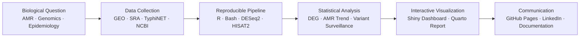
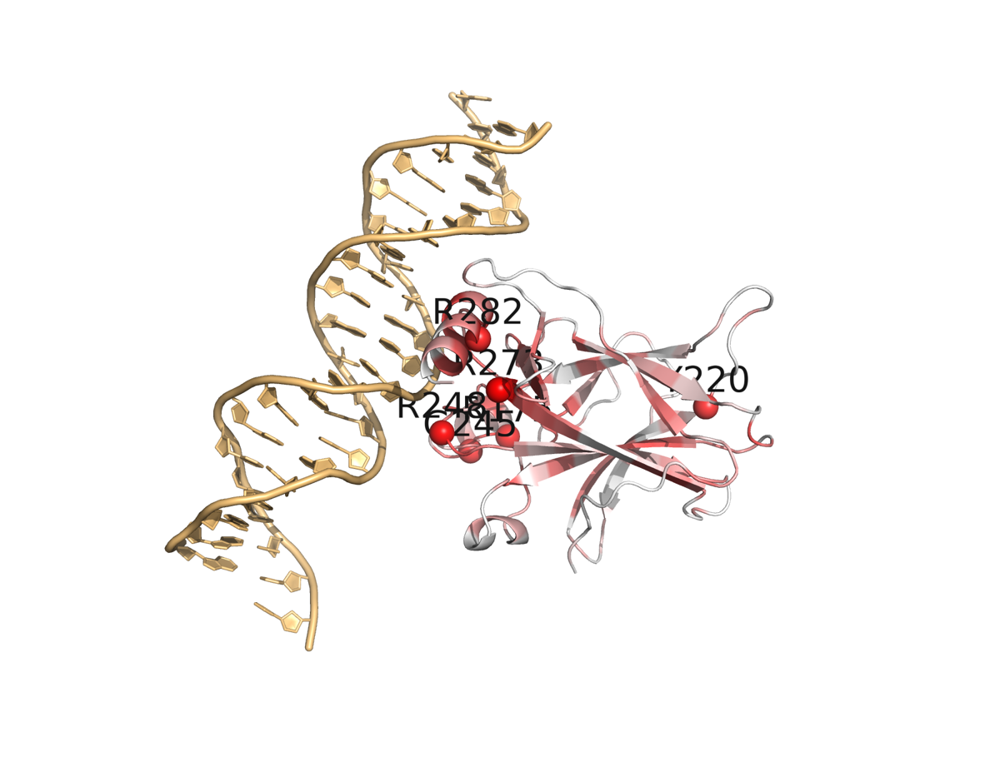
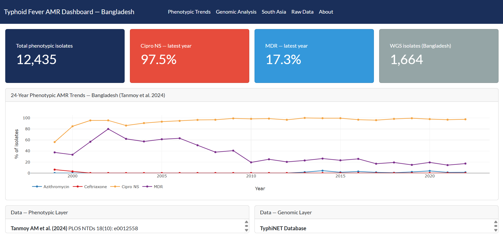
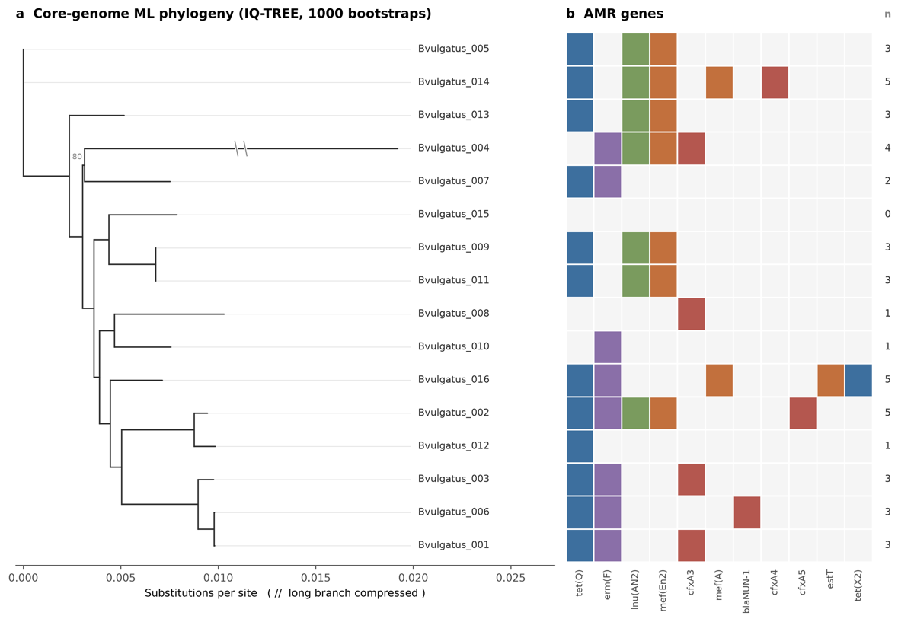
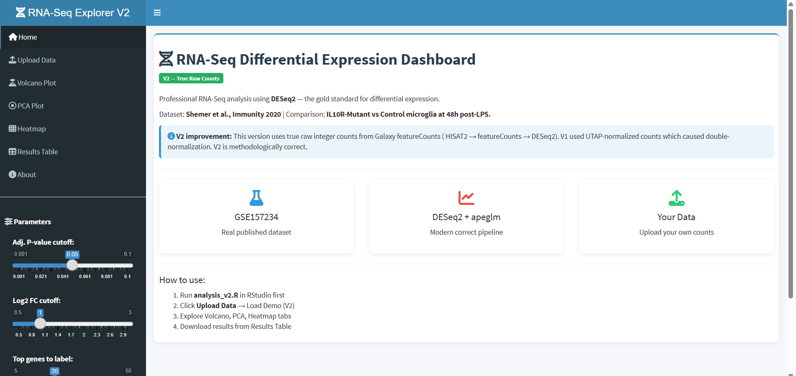
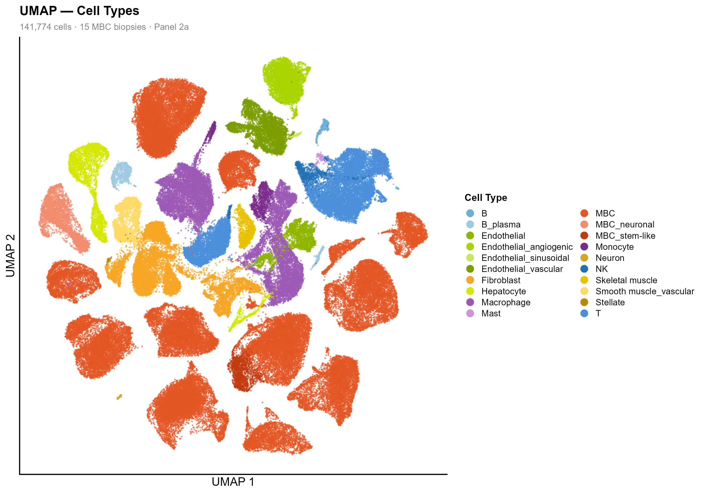
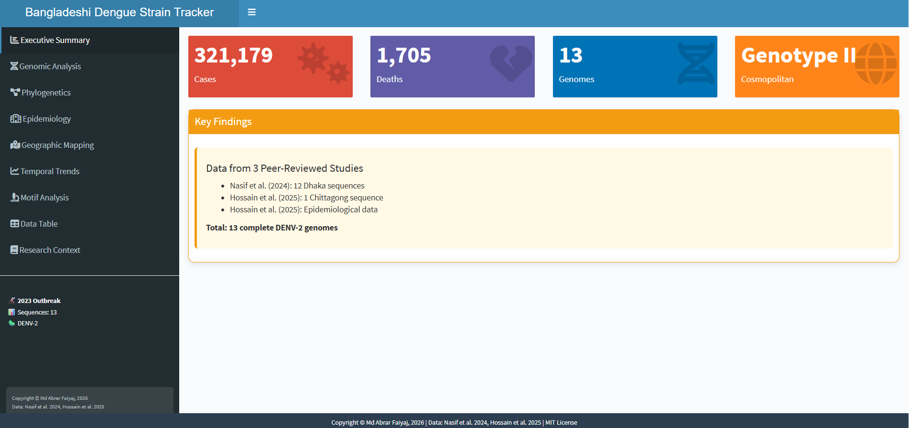
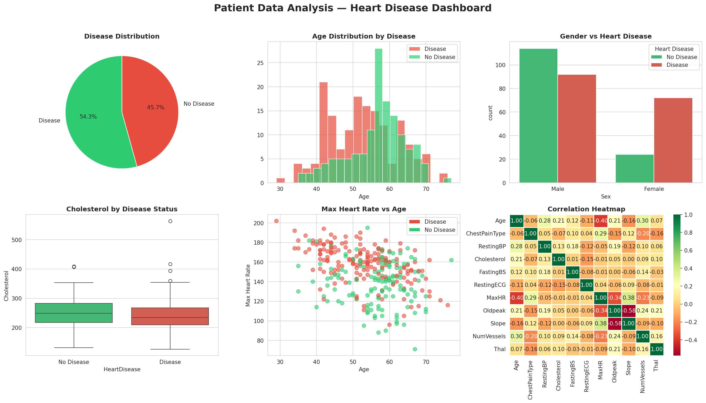

# Hi, I'm Md Abrar Faiyaj 👋

**M.S. in Biotechnology, BRAC University | Junior Research Collaborator | Bioinformatics**  
**Reproducible pipelines and analyses in microbial genomics, AMR surveillance and cancer structural bioinformatics**

---

## 🔬 What I Work On

I work at the intersection of **infectious disease biology**, **cancer genomics** and **computational data analysis** — turning messy genomic and epidemiological datasets into reproducible, interactive tools that researchers can actually use.

---

## 🧰 Technical Toolkit

**Languages & Frameworks**

**Bioinformatics & Genomics**

**Structural Bioinformatics**

**Visualization & Dashboards**

**Tools & Reproducibility**

---

## 🚀 Featured Projects

### 1. Cancer Mutation Hotspots in 3D — TP53, KRAS and PIK3CA

Mapped about 5,000 TCGA missense mutations from 32 cancer types onto experimental (PDB) and predicted (AlphaFold) protein structures to ask where cancer mutations sit in 3D, and why.

**Highlights:**
- Oncogene vs. tumor suppressor pattern: KRAS mutations hit 32 positions (73% at G12), TP53 mutations spread over 173
- Separated TP53 DNA-contact hotspots (R248, R273) from structural hotspots (R175, Y220, zinc-site C176/H179)
- Permutation tests for 3D clustering; distances to DNA and GDP; interactive 3Dmol.js viewers

**Tech:** `Python` `Biopython` `cBioPortal API` `PDB` `AlphaFold` `PyMOL` `3Dmol.js`

[🔗 View Repository](https://github.com/mdabrarfaiyaj/cancer-mutation-3d-hotspots) · [🧬 Interactive 3D](https://mdabrarfaiyaj.github.io/cancer-mutation-3d-hotspots/results/interactive/TP53_3D.html) · [📝 Blog post](https://mdabrarfaiyaj.github.io/posts/Where-Do-Cancer-Mutations-Sit-in-3D/)

---

### 2. Typhoid Fever AMR Surveillance Dashboard — Bangladesh (1999–2022)

A 24-year retrospective analysis of *Salmonella* Typhi antimicrobial resistance trends in Bangladesh, extending Tanmoy et al. 2024 (PLOS NTDs) with TyphiNET genomic data. Fully deployed as an interactive Shiny dashboard and a Quarto report on GitHub Pages.

**Highlights:**
- Integrated clinical AMR phenotype data with whole-genome sequencing genotype data from TyphiNET
- Visualized multi-drug resistance (MDR), XDR, and H58 lineage trends over 24 years
- Deployed interactive Shiny dashboard with tabbed navigation and downloadable outputs
- Published reproducible Quarto report with embedded figures and methodology

**Tech:** `R` `Shiny` `ggplot2` `Quarto` `renv` `GitHub Pages` `TyphiNET` `AMR genomics`

[🔗 View Repository](https://github.com/mdabrarfaiyaj/Typhoid-Fever-in-Bangladesh) · [📊 Live Dashboard](https://u3j9z9-md0abrar-faiyaj.shinyapps.io/typhoid-amr-bangladesh/) · [📄 Quarto Report](https://mdabrarfaiyaj.github.io/Typhoid-Fever-in-Bangladesh/) · [📝 Blog post](https://mdabrarfaiyaj.github.io/posts/Typhoid-in-Bangladesh-Why-Falling-Resistance-Can-Still-Be-Bad-News/)

---

### 3. Bacterial Pangenome & AMR Pipeline — *Bacteroides vulgatus*

A modular Nextflow DSL2 pipeline that takes bacterial genomes from QC to annotation, pangenome, resistance genes and a core-genome tree, run on 16 human gut isolates.

**Highlights:**
- Only 30% of 8,697 gene families are shared by all strains
- 11 resistance genes, none in every strain; *lnu(AN2)* and *mef(En2)* always co-occur, suggesting a shared mobile element
- Resistance genes do not follow the core-genome phylogeny

**Tech:** `Nextflow` `Prokka` `Panaroo` `AMRFinderPlus` `IQ-TREE` `Python`

[🔗 View Repository](https://github.com/mdabrarfaiyaj/human-gut-bacterial-pangenome-analysis) · [📝 Blog post](https://mdabrarfaiyaj.github.io/posts/Same-Species-Different-Genes-The-Pangenome-of-a-Gut-Bacterium/)

---

### 4. RNA-Seq Replication — Shemer et al., *Immunity* 2020 (GSE157234)

Reproduced bulk RNA-Seq analysis from a high-impact immunology paper on IL-10 receptor-deficient microglia. Discovered that the GEO deposit contains UTAP-normalized counts (not raw counts) — a methodological finding documented publicly and shared with the research community, attracting engagement from scientists at Illumina, Novartis, Pfizer, and GSK.

**Highlights:**
- Rebuilt the analysis from raw SRA reads (HISAT2 → featureCounts → DESeq2 with apeglm shrinkage)
- V2 finds 1,597 DEGs (paper: 1,647), with *Tnf*, *Il6*, *Il12b* up and homeostatic markers *Tmem119*, *P2ry12* down
- Documented the GEO normalized-counts issue publicly, reaching 6,300+ LinkedIn impressions

**Tech:** `R` `DESeq2` `apeglm` `ggplot2` `pheatmap` `Shiny` `GEO` `SRA` `Bioconductor`

[🔗 View Repository](https://github.com/mdabrarfaiyaj/rna-seq-shiny-pipeline) · [📊 Live Dashboard](https://019cd22f-689b-acc2-4b56-472725ef4a7b.share.connect.posit.cloud/) · [📝 Blog post](https://mdabrarfaiyaj.github.io/posts/Why-I-Rebuilt-My-RNA-seq-Analysis-From-Raw-Reads/)

---

### 5. Metastatic Breast Cancer Single-Cell Atlas — Klughammer et al., *Nature Medicine* 2024

Reanalysis of 15 single-cell and single-nucleus RNA-seq biopsies to ask what shapes metastatic breast cancer cells.

**Highlights:**
- Malignant-cell expression is dominated by patient identity (~43% of variance), not biopsy site (~0.1%)
- Corrected a strong fresh-cell vs. frozen-nucleus technical effect with Harmony and ComBat
- Verified every clinical label against the paper's supplementary tables

**Tech:** `R` `Harmony` `ComBat` `variancePartition` `pseudobulk` `Quarto`

[🔗 View Repository](https://github.com/mdabrarfaiyaj/sc-snRNA-seq-metastatic-breast-cancer) · [🌐 Project website](https://mdabrarfaiyaj.github.io/sc-snRNA-seq-metastatic-breast-cancer/) · [📝 Blog post](https://mdabrarfaiyaj.github.io/posts/Patient-Not-Place-What-Shapes-Metastatic-Breast-Cancer-Cells/)

---

### 6. Bangladesh Dengue Genomic Surveillance Dashboard

Interactive R Shiny dashboard analyzing DENV-2 sequences from the 2023 Bangladesh dengue outbreak (Dhaka & Chattogram isolates). Includes QC filtering, motif detection, and comparative visualization.

**Highlights:**
- Analyzed 13 real DENV-2 sequences from the 2023 Bangladesh outbreak
- Sequence quality control (length, GC content, ambiguous bases) and motif counts across isolates
- Deployed interactive dashboard with modern tabbed UI

**Tech:** `R` `Shiny` `Bioconductor` `sequence analysis` `genomic surveillance`

[🔗 View Repository](https://github.com/mdabrarfaiyaj/bangladeshi-dengue-strain-tracker) · [📊 Live Dashboard](https://u3j9z9-md0abrar-faiyaj.shinyapps.io/bangladesh-denv-tracker/) · [📝 Blog post](https://mdabrarfaiyaj.github.io/posts/Building-My-First-Dashboard-Dengue-in-Bangladesh/)

---

### 7. Heart Disease Patient Data Analysis

Python + SQL exploration of the Kaggle heart disease dataset, which turned into a lesson in data quality.

**Highlights:**
- Found that the 1,025 rows contain only 302 unique patients
- Showed that the disease labels in this dataset version appear reversed (checked against the original Cleveland study)
- SQLite queries and a six-panel Matplotlib/Seaborn dashboard

**Tech:** `Python` `SQL` `SQLite` `Pandas` `Matplotlib` `Seaborn` `Jupyter`

[🔗 View Repository](https://github.com/mdabrarfaiyaj/patient-data-analysis) · [📝 Blog post](https://mdabrarfaiyaj.github.io/posts/When-My-Data-Disagreed-With-the-Textbook/)

---

## 📝 Blog

I write about each project for a general audience: the question, what I did, and what the results mean, including the mistakes I found along the way.

**[Read all posts → mdabrarfaiyaj.github.io](https://mdabrarfaiyaj.github.io/archives/)**

---

## 📚 Research Interests

- Infectious Disease Genomics & AMR Surveillance
- Cancer Genomics & Structural Bioinformatics
- RNA-Seq & Multi-omics Data Analysis
- Reproducible Bioinformatics Tools & Workflows
- Public Health Data Science
- Computational Biology & Interactive Dashboards

---

## 📫 Let's Connect

- **Email**: faiyaj.mdabrar@gmail.com
- **ORCID**: [0009-0005-9646-4508](https://orcid.org/0009-0005-9646-4508)
- **LinkedIn**: [md-abrar-faiyaj](https://www.linkedin.com/in/md-abrar-faiyaj-559246381/)
- **Website & blog**: [mdabrarfaiyaj.github.io](https://mdabrarfaiyaj.github.io/)

Open to **research collaborations**, bioinformatics roles, and PhD opportunities in computational biology, infectious disease genomics and cancer genomics.

---

*Last updated: October 2026*
